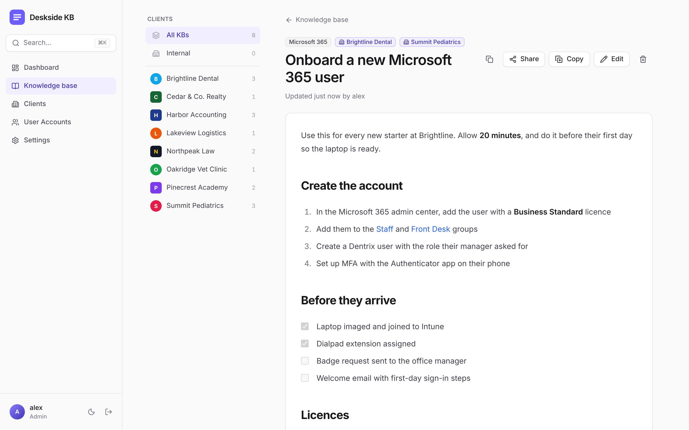

# Deskside KB

**The knowledge base for IT teams that support many clients.** Keep every how-to, client procedure and onboarding checklist in one fast, searchable place, organised by client, and share a single article with a link when someone outside the team needs it.

Deskside KB runs entirely on Cloudflare Workers and D1, which have a generous free tier: no servers to look after and no per-seat pricing. Deploy it once and your technicians can sign in straight away.



## Why Deskside KB

- **Built around your clients.** Every KB can belong to one client, several, or none (internal). The client list sits beside every article, so one click shows everything for that client.
- **Writing that doesn't get in the way.** A clean rich text editor with headings, colours, checklists, tables and screenshots you can paste straight in. Nobody has to learn Markdown.
- **Find anything in seconds.** Full-text search across every article, plus a ⌘K / Ctrl+K command palette.
- **Client pages your team will actually use.** Each client has a logo, the services and software they run (Dialpad, Microsoft 365, Dentrix and so on) with a checkmark for each, and dedicated **Information** and **New Hire Procedure** sections.
- **Share without handing out accounts.** Create a public link to a single KB, images included, and switch it off again whenever you like.
- **The right access for everyone.** Admins, technicians and read-only viewers, each with their own username and password.

## Features

### Knowledge base
- Compact list you can filter by client and category, and sort by last updated, oldest first or title
- Rich text editor with font size, text colour, bold, italic, underline, alignment, indent, bulleted and numbered lists, checklists, tables, links, code, quotes and a **Remove spacing** button that tidies blank lines in one click
- Paste or drag in screenshots, resize them by dragging a corner, and click any image to zoom
- **Copy** starts a new KB from an existing one; Ctrl/⌘+S saves
- **Select multiple** to change the category or clients of many KBs at once (admins can also delete them)
- Categories that admins manage and reorder

### Clients
- Alphabetical client list with logos (margins are trimmed automatically on upload)
- A services panel at the top of each client, grouped by category and sorted A–Z, which technicians tick, rename and organise in place
- Side-by-side **Information** and **New Hire Procedure** sections with full rich text and images
- Every KB for that client at the bottom of its page

### Team and settings
- Dashboard with totals and the most recently updated KBs
- Your own site name, logo (also used as the browser tab icon) and accent colour, shown on the sign-in page too
- Optional public read-only viewing, so anyone can browse without signing in while editing stays behind a login
- Light and dark mode, and a layout that works on phones

### Roles

| Role | Can do |
| --- | --- |
| **Admin** | Everything, including deleting KBs and clients, editing client Information and New Hire Procedure, site settings and user accounts |
| **Technician** | Create and edit KBs, client names, logos and services, and share links |
| **Viewer** | Read only |

## Get started

1. Fork this repository and connect it to Cloudflare under **Workers & Pages → Create → Import a repository**. The deploy command is `npx wrangler deploy`.
2. Cloudflare builds the app, creates the D1 database on the first deploy and publishes the site. Every push to `main` deploys again.
3. Open the site and create the first admin account. That screen only appears while there are no users, so do this right after the first deploy.
4. Add your technicians under **User Accounts**, then your clients, and start writing.

The app creates and upgrades its own database tables, so there are no migrations to run by hand.

## Under the hood

- **Cloudflare Workers** serve the API ([Hono](https://hono.dev)) and the React app from one Worker
- **Cloudflare D1** (SQLite) stores everything, including images, which are shrunk in the browser before upload and only served to people allowed to see them
- **React 19**, **Tailwind CSS v4** and **Vite** for the interface
- **Tiptap** for the editor. Articles are stored as Markdown, so search and share links work on plain text, and the reader only allows the few inline styles the editor produces (colour, size and alignment)
- Passwords are hashed and sessions are cookie based, and writes are protected against cross-site requests

## Local development

```sh
npm install
npm run build && npm run dev   # http://localhost:8787 with a local database
```

For hot reload of the UI, run `npm run dev` in one terminal and `npm run dev:ui` in another, then open the Vite URL.

Schema changes go in `worker/schema.ts` as a new entry in `MIGRATIONS`.

## Project layout

- `worker/`: API, authentication and database schema
- `src/`: React app
- `docs/`: screenshot used in this README
- `wrangler.jsonc`: Cloudflare configuration
